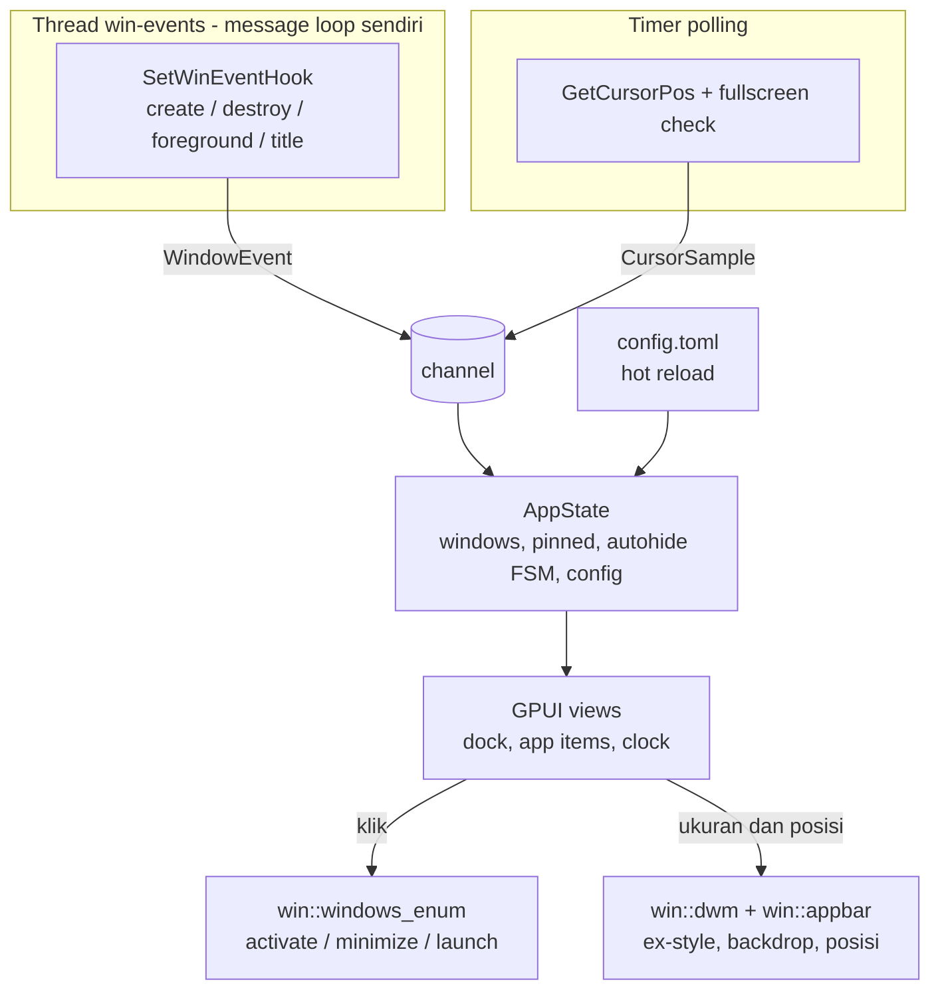

# Rencana Implementasi: Dockwind (Dock Bar Pengganti Taskbar Windows 10/11 dengan Rust)

Dockwind adalah dock bar mengambang untuk Windows 10/11 yang menampilkan daftar aplikasi (pinned dan yang sedang berjalan), jam dan tanggal, serta auto hide/show. Tampilannya bisa transparan/translucent, radius sudut dan warna background bisa diatur lewat file konfigurasi. Dockwind menggantikan taskbar bawaan dengan cara menyembunyikannya, bukan menghapusnya.

---

## Latar Belakang & Tujuan

### Latar Belakang
1. Taskbar bawaan Windows tidak bisa dikustomisasi untuk transparansi, radius sudut, maupun warna.
2. Proyek dimulai dari nol (greenfield): belum ada kode. Semua file di bawah berstatus `[NEW]`.
3. UI direncanakan memakai GPUI (framework UI dari Zed), sedangkan integrasi sistem memakai crate `windows` (windows-rs). GPUI belum stabil dan dokumentasinya minim, jadi kelayakannya harus dibuktikan dulu sebelum fitur dibangun (Milestone M0).

### Tujuan
1. Dock tampil di tepi bawah layar utama, tanpa tombol di taskbar dan tanpa muncul di Alt+Tab.
2. Menampilkan app list: aplikasi pinned (dari config) dan jendela yang sedang berjalan, dengan ikon, indikator "sedang berjalan/aktif", dan klik untuk mengaktifkan atau meminimalkan.
3. Menampilkan jam dan tanggal yang diperbarui otomatis.
4. Auto hide/show: dock tersembunyi, muncul saat kursor menyentuh tepi layar, dan hilang lagi setelah kursor menjauh.
5. Tampilan dapat dikonfigurasi: background transparan/translucent (RGBA), radius sudut, warna, ukuran ikon, dengan hot reload.
6. Taskbar bawaan dapat disembunyikan dan selalu dipulihkan dengan aman.

---

## User Review Required

> [!IMPORTANT]
> **Definisi "menggantikan taskbar"**
> Dockwind menyembunyikan `Shell_TrayWnd` (dan `Shell_SecondaryTrayWnd` untuk monitor tambahan), tidak menghentikan `explorer.exe`. Tombol Start, system tray, jam sistem, notification center, dan badge notifikasi **tidak** digantikan di v1. Pengguna tetap bisa memakai tombol Win di keyboard untuk Start.

> [!IMPORTANT]
> **Blur dan radius kustom bisa saling bertentangan**
> Efek blur resmi dari DWM (`DWMWA_SYSTEMBACKDROP_TYPE`, Windows 11 22H2+) mengisi seluruh persegi jendela, sedangkan radius yang bisa diatur digambar oleh UI di atas jendela transparan. Rencana ini menetapkan dua mode:
> 1. **`blur = "none"`**: transparansi per-pixel + radius bebas (gambar sendiri). Mode ini wajib berfungsi.
> 2. **`blur = "mica" | "acrylic"`**: blur DWM, dengan sudut dari `DWMWA_WINDOW_CORNER_PREFERENCE` (radius tetap) atau `SetWindowRgn` (tepi bergerigi). Radius bebas tidak dijamin di mode ini.
>
> Klaim ini harus dibuktikan di M0 sebelum dijadikan kontrak. Hasilnya dicatat di `docs/spike-m0.md`.

> [!IMPORTANT]
> **Dukungan Windows 10**
> Windows 10 tidak punya backdrop resmi DWM. Target v1 di Windows 10: transparansi + radius bebas (mode `none`). Blur di Windows 10 memakai API tidak resmi (`SetWindowCompositionAttribute`), dan itu **di luar MVP**.

> [!WARNING]
> **Risiko kehilangan taskbar jika Dockwind crash**
> Jika proses berhenti saat taskbar bawaan disembunyikan, pengguna tinggal tanpa taskbar. Pengamannya:
> - Saat pengembangan (sebelum M6), `hide_native_taskbar` default `false`.
> - Taskbar dipulihkan lewat `Drop` guard, panic hook, handler Ctrl+C/`WM_ENDSESSION`, dan perintah `dockwind --restore-taskbar` yang berdiri sendiri.
> - Hotkey global (default `Ctrl+Alt+Shift+Q`) dan menu konteks pada dock untuk keluar dengan aman.

> [!NOTE]
> **Status klaim tentang GPUI**
> Hal-hal berikut berasal dari dokumentasi pihak ketiga dan **belum diverifikasi di proyek ini**: window GPUI mengekspos `raw-window-handle` 0.6 (HWND), `WindowKind::PopUp` di Windows membuat tool window top-most tanpa owner, dan ada opsi window background transparan/blur. Agent wajib memverifikasinya dari source snapshot GPUI yang di-pin, bukan dari ingatan.

## Open Questions

- **Pendekatan UI.** Apakah rencana "GPUI + gerbang keputusan di M0" disetujui? Jika M0 gagal (transparansi per-pixel atau kontrol style jendela tidak bisa dicapai), agent berhenti dan melapor, lalu pilihan fallback dibahas: UI Direct2D/DirectComposition via windows-rs, Slint, atau Tauri (WebView2).
- **Batas dukungan Windows 10.** Apakah mode tanpa blur di Windows 10 (transparan + radius bebas) dapat diterima untuk v1?

---

## Arsitektur



Prinsip desain:
- **Logika murni dipisah dari Win32** (filter jendela, pengelompokan, state machine auto hide, perhitungan posisi/DPI, parsing config). Bagian ini mudah diuji tanpa GUI.
- **Hook Win32 berjalan di thread sendiri** dengan message loop sendiri, lalu mengirim event lewat channel ke sisi UI. Cara membangunkan UI GPUI dari thread lain (misalnya async channel + task) diverifikasi di M0.
- Semua kode Win32 berada di bawah `src/win/` dan hanya di sana yang memakai `unsafe`.

---

## Aturan untuk Agent Eksekusi

1. Kerjakan berurutan M0 → M7. Jangan lanjut ke milestone berikutnya sebelum kriteria selesai milestone saat ini terpenuhi.
2. Satu commit (atau lebih) per milestone, pesan commit memuat nomor milestone.
3. **M0 adalah gerbang.** Jika gagal, berhenti, tulis temuan di `docs/spike-m0.md`, dan tunggu keputusan pengguna.
4. Pin versi/commit GPUI secara eksak di `Cargo.toml`. Jangan memakai `*` atau branch yang bergerak. Samakan versi crate `windows` dengan yang dipakai GPUI (cek `cargo tree -d`) agar tipe tidak ganda.
5. Verifikasi API GPUI dari source snapshot yang di-pin. Jangan mengarang nama fungsi.
6. Semua `unsafe` dibungkus fungsi aman kecil dengan komentar `// SAFETY:`.
7. Jangan menyembunyikan taskbar bawaan di mesin pengembangan sebelum M6 selesai dan `--restore-taskbar` terbukti bekerja.
8. Setiap milestone harus lolos `cargo fmt --check`, `cargo clippy --all-targets -- -D warnings`, dan `cargo test`.
9. Jika menyimpang dari rencana (struktur file, pilihan crate), catat di `docs/decisions.md` dengan satu paragraf alasan.
10. Ketidakjelasan yang menghalangi: berhenti dan tanyakan, jangan menebak.

---

## Proposed Changes

### 1. Scaffold Proyek

#### [NEW] `Cargo.toml`
- Crate biner `dockwind`, edition 2021 atau lebih baru, target `x86_64-pc-windows-msvc`.
- Dependensi: GPUI (di-pin, bentuk snapshot crate atau git rev diputuskan di M0 dan dicatat), `windows` (fitur: `Win32_Foundation`, `Win32_UI_WindowsAndMessaging`, `Win32_UI_Shell`, `Win32_UI_Accessibility`, `Win32_Graphics_Dwm`, `Win32_Graphics_Gdi`, `Win32_System_Threading`, `Win32_System_Registry`, `Win32_UI_HiDpi`, `Win32_UI_Input_KeyboardAndMouse`), `raw-window-handle` 0.6, `serde`, `toml`, `chrono`, `anyhow`, `thiserror`, `tracing`, `tracing-subscriber`, `tracing-appender`, `dirs`, `notify` (hot reload).
- Profil `release`: `lto = "thin"`, `codegen-units = 1`, `strip = true`.
- Cek ketersediaan nama `dockwind` di crates.io (`cargo search dockwind`) dan catat hasilnya di `docs/decisions.md`.

#### [NEW] `rust-toolchain.toml`
- Pin toolchain stable dan target MSVC. Prasyarat build (Visual Studio Build Tools dengan C++ dan Windows SDK, serta syarat tambahan GPUI) dicatat di `README.md` setelah diverifikasi dari repo GPUI yang di-pin.

#### [NEW] `build.rs` dan `assets/dockwind.manifest`
- Manifest aplikasi: DPI awareness per-monitor v2, `longPathAware`, dan identitas aplikasi. Verifikasi dulu apakah GPUI sudah mengatur DPI awareness. Jika sudah, hindari konflik dan cukup satu sumber.

#### [NEW] `.gitignore`, `README.md`, `docs/decisions.md`
- README: tujuan, fitur, cara build, lokasi config, cara `--restore-taskbar`. `decisions.md`: catatan keputusan dan penyimpangan.

---

### 2. Konfigurasi dan Tema

#### [NEW] `src/config.rs`
- Struct `Config` (`serde`), dengan nilai default untuk semua field sehingga file config sebagian tetap valid.
- Lokasi: `%APPDATA%\Dockwind\config.toml`. Jika belum ada, dibuat dari default saat pertama kali jalan.
- Validasi: radius ≥ 0 dan dibatasi `min(tinggi/2)`, ukuran ikon dalam rentang 16–128, warna RGBA hex valid (`#RRGGBB` atau `#RRGGBBAA`). Nilai tidak valid memunculkan log peringatan lalu memakai default, tidak membuat aplikasi crash.
- Watcher (`notify`) untuk hot reload dengan debounce ± 200 ms. Config yang rusak saat reload diabaikan dan config terakhir yang valid dipertahankan.

Kontrak file config:

```toml
[appearance]
background = "#1E1E2ECC"   # RGBA hex
corner_radius = 16         # px logis
blur = "none"              # none | mica | acrylic
icon_size = 40
padding = 8
margin_bottom = 12

[behavior]
auto_hide = true
show_delay_ms = 80
hide_delay_ms = 400
animation_ms = 180
reserve_space = false      # true = daftarkan sebagai AppBar (jendela lain tidak menimpa dock)
hide_native_taskbar = false  # default false sampai M6 selesai; target rilis: true
hide_in_fullscreen = true
quit_hotkey = "Ctrl+Alt+Shift+Q"

[clock]
time_format = "%H:%M"
date_format = "%a, %d %b %Y"
locale = "en"              # opsional: "id" jika fitur locale chrono diaktifkan

[[pinned]]
name = "Terminal"
path = "C:\\Windows\\System32\\cmd.exe"
args = []
```

#### [NEW] `src/theme.rs`
- Struct `Theme` turunan dari `Config.appearance`: warna latar, warna teks (kontras otomatis dari luminansi latar), warna indikator aplikasi aktif/berjalan, radius, padding. Fungsi murni `Theme::from_config` agar mudah diuji.

---

### 3. Lapisan Win32 (`src/win/`)

Semua file di bawah `#[cfg(windows)]`. Tipe publik berupa struct Rust biasa, bukan `HWND`/`HICON` mentah, kecuali handle yang memang dibutuhkan.

#### [NEW] `src/win/mod.rs`
- Re-export modul dan tipe `WinError`.

#### [NEW] `src/win/windows_enum.rs`
- `struct WindowInfo { hwnd, title, exe_path, pid, is_minimized, is_foreground }`.
- `fn list_app_windows() -> Vec<WindowInfo>` memakai `EnumWindows`. Predikat filter murni `fn is_taskbar_worthy(flags: &WindowFlags) -> bool`:
  - harus terlihat (`IsWindowVisible`), bukan cloaked (`DwmGetWindowAttribute` + `DWMWA_CLOAKED`, penting untuk aplikasi UWP),
  - tidak punya owner (`GetWindow(GW_OWNER)`) atau punya `WS_EX_APPWINDOW`,
  - bukan `WS_EX_TOOLWINDOW` (kecuali `WS_EX_APPWINDOW`),
  - judul tidak kosong, dan bukan jendela Dockwind sendiri.
- `fn activate(hwnd)`: jika minimize → `ShowWindow(SW_RESTORE)`; lalu `SetForegroundWindow`. Jika sudah foreground, klik meminimalkan (`SW_MINIMIZE`). Tangani batasan foreground-lock dengan cara yang terdokumentasi, dan catat batasannya.
- Proses → path exe: `OpenProcess(PROCESS_QUERY_LIMITED_INFORMATION)` + `QueryFullProcessImageNameW`. Aplikasi UWP (host `ApplicationFrameHost.exe`) dicatat sebagai batasan v1 jika identitas aslinya sulit dipetakan.

#### [NEW] `src/win/icons.rs`
- `fn icon_for_window(hwnd) -> Option<RgbaImage>`: urutan `WM_GETICON` (`SendMessageTimeoutW`, `ICON_BIG`) → `GetClassLongPtrW(GCLP_HICON)` → ikon dari exe (`SHGetFileInfoW`/`ExtractIconExW`).
- Konversi `HICON` → RGBA: `GetIconInfo` + `GetDIBits`, tangani alpha dan masker. Cache per path exe, dengan batas ukuran cache.

#### [NEW] `src/win/events.rs`
- Thread `win-events` dengan message loop (`GetMessageW`/`DispatchMessageW`) yang memasang `SetWinEventHook` (`WINEVENT_OUTOFCONTEXT`) untuk `EVENT_OBJECT_SHOW`, `EVENT_OBJECT_HIDE`, `EVENT_OBJECT_DESTROY`, `EVENT_OBJECT_NAMECHANGE`, `EVENT_SYSTEM_FOREGROUND`, `EVENT_SYSTEM_MINIMIZESTART`, `EVENT_SYSTEM_MINIMIZEEND`.
- Hanya meneruskan event dengan `idObject == OBJID_WINDOW`. Event dikirim sebagai `enum WindowEvent` ke channel. Callback harus ringan, tanpa alokasi besar atau I/O.
- Unhook bersih saat shutdown.

#### [NEW] `src/win/dwm.rs`
- `fn apply_dock_styles(hwnd)`: set ex-style `WS_EX_TOOLWINDOW | WS_EX_TOPMOST` (+ `WS_EX_NOACTIVATE` jika terbukti tidak mengganggu fokus aplikasi target), tanpa `WS_EX_APPWINDOW`.
- `fn set_backdrop(hwnd, BlurMode)`: `DwmSetWindowAttribute` dengan `DWMWA_SYSTEMBACKDROP_TYPE` hanya jika build Windows ≥ 22621; selain itu kembali ke mode tanpa blur dengan log informasi.
- `fn set_corner_preference(hwnd, pref)` via `DWMWA_WINDOW_CORNER_PREFERENCE`.
- `fn windows_build() -> u32` untuk deteksi versi (hindari API yang dideprekasi untuk deteksi versi; gunakan `RtlGetVersion` atau `GetProductInfo`).

#### [NEW] `src/win/monitors.rs`
- `struct MonitorInfo { rect, work_area, dpi_scale }` untuk monitor utama (`MonitorFromPoint`, `GetMonitorInfoW`, `GetDpiForMonitor`). Menangani `WM_DPICHANGED` dan `WM_DISPLAYCHANGE` dengan menghitung ulang posisi.
- Fungsi murni `fn dock_rect(monitor, content_size, margin, dpi) -> Rect` agar dapat diuji.

#### [NEW] `src/win/appbar.rs`
- Dipakai hanya saat `reserve_space = true`. `SHAppBarMessage` dengan `ABM_NEW`, `ABM_QUERYPOS`, `ABM_SETPOS`, `ABM_REMOVE`, dan penanganan callback message (`ABN_POSCHANGED`, `ABN_FULLSCREENAPP`).
- `ABM_REMOVE` wajib dipanggil saat shutdown (bagian dari guard pemulihan).

#### [NEW] `src/win/taskbar.rs`
- `fn hide_native() / fn restore_native()`: `FindWindowW("Shell_TrayWnd")` dan `Shell_SecondaryTrayWnd` → `ShowWindow(SW_HIDE/SW_SHOW)`. Simpan status awal agar tidak menampilkan taskbar yang memang disembunyikan pengguna.
- `struct TaskbarGuard` dengan `Drop` yang memanggil `restore_native`.
- Daftarkan pesan `RegisterWindowMessageW("TaskbarCreated")` dan sembunyikan ulang taskbar saat explorer restart.
- `fn install_panic_hook()` yang memanggil `restore_native` sebelum panic dilanjutkan, dan handler `SetConsoleCtrlHandler`/`WM_ENDSESSION`.

#### [NEW] `src/win/cursor.rs`
- `fn cursor_pos() -> (i32, i32)` (`GetCursorPos`).
- `fn fullscreen_active() -> bool` memakai `SHQueryUserNotificationState` (`QUNS_BUSY`, `QUNS_RUNNING_D3D_FULL_SCREEN`, `QUNS_PRESENTATION_MODE`).

#### [NEW] `src/win/launch.rs`
- `fn launch(path, args)` dengan `ShellExecuteW` agar `.exe`, `.lnk`, dan URI aplikasi bisa diluncurkan. Jangan menjalankan perintah lewat shell string; path dan argumen dilewatkan terpisah.

#### [NEW] `src/win/hotkey.rs`
- Registrasi hotkey global (`RegisterHotKey`) dari `quit_hotkey`; parsing string hotkey adalah fungsi murni yang diuji.

#### [NEW] `src/win/autostart.rs`
- Tambah/hapus entri `HKCU\Software\Microsoft\Windows\CurrentVersion\Run` untuk `Dockwind`. Dipanggil dari menu konteks, tidak aktif otomatis.

---

### 4. State Aplikasi

#### [NEW] `src/app_state.rs`
- `AppState`: daftar `DockItem` (pinned + berjalan), config aktif, `AutoHideState`, jam.
- `struct DockItem { key: exe_path, name, icon, windows: Vec<hwnd>, is_pinned, is_running, is_active }`.
- Pengelompokan: satu ikon per exe; jendela dengan exe yang sama digabung. Klik pada grup: aktifkan jendela terakhir yang aktif, atau luncurkan jika tidak berjalan. Aplikasi pinned tampil di posisi sesuai urutan config, aplikasi tidak-pinned berjalan ditambahkan setelahnya.
- Fungsi murni `fn apply_event(&mut self, WindowEvent)` dan `fn merge(pinned, running) -> Vec<DockItem>`.

#### [NEW] `src/autohide.rs`
- State machine murni dengan waktu diinjeksi (tanpa memanggil jam sistem): `Hidden → PendingShow → Showing → Visible → PendingHide → Hiding → Hidden`.
- Input: `CursorSample { pos, now }`, `dock_rect`, zona pemicu (pita 1–2 px di tepi bawah monitor dock), `show_delay`, `hide_delay`, `animation_ms`, flag `force_hidden` (fullscreen), flag `pinned_open` (menu konteks/drag terbuka).
- Output: `progress: f32` (0 = tersembunyi, 1 = tampil penuh) dengan easing, dipakai UI untuk posisi/opasitas.
- Polling kursor memakai timer ± 100 ms saat `Hidden` dan ± 16 ms saat animasi atau terlihat, agar CPU idle rendah. Hook mouse global (`WH_MOUSE_LL`) sengaja tidak dipakai.

---

### 5. Lapisan UI (`src/ui/`)

Nama API GPUI diverifikasi di source yang di-pin; bagian ini hanya menetapkan perilaku.

#### [NEW] `src/ui/mod.rs`
- Pembuatan window: borderless, transparan, tanpa dekorasi, ukuran mengikuti konten, posisi dari `dock_rect`, lalu `win::dwm::apply_dock_styles` dan `set_backdrop` lewat HWND dari raw handle.

#### [NEW] `src/ui/dock.rs`
- View root: rounded rect memakai `Theme` (warna RGBA, radius), padding, tata letak horizontal: app list di kiri/tengah, pemisah tipis, lalu widget jam di kanan.
- Menerapkan `autohide.progress` ke posisi vertikal (geser keluar tepi bawah) dan opasitas.
- Menu konteks klik kanan: Reload config, Autostart on/off, Restore taskbar & Quit.

#### [NEW] `src/ui/app_item.rs`
- Ikon (`icon_size`), indikator kecil di bawah ikon untuk "berjalan" dan indikator lebih menonjol untuk "aktif", efek hover, tooltip nama aplikasi. Klik kiri: aktifkan/minimize/luncurkan. Klik tengah: luncurkan instance baru (jika pinned).

#### [NEW] `src/ui/clock.rs`
- Dua baris teks (jam dan tanggal) memakai `chrono::Local` dan format dari config. Perbarui pada pergantian menit (atau detik jika format memuat detik); jangan memakai interval tetap yang boros. Tangani perubahan zona waktu/jam sistem dengan menghitung ulang saat wake.

---

### 6. Entry Point

#### [NEW] `src/main.rs`
- Parse argumen: `--restore-taskbar` (jalankan `restore_native`, lalu keluar tanpa membuka GPUI), `--config <path>`, `--log-level`.
- Urutan startup: logging → muat config → single-instance guard (named mutex) → `install_panic_hook` → buat `TaskbarGuard` (jika `hide_native_taskbar`) → jalankan thread `win-events` → jalankan aplikasi GPUI → daftarkan hotkey.
- Shutdown bersih: unhook, `ABM_REMOVE`, `restore_native`, simpan log terakhir.
- Log ke `%LOCALAPPDATA%\Dockwind\logs\` dengan rotasi harian.

---

### 7. Tes

#### [NEW] `tests/` dan modul `#[cfg(test)]`
- `config` : default lengkap, parsing sebagian, validasi (radius/ikon/warna tidak valid), hot reload mengabaikan config rusak.
- `theme` : warna teks kontras dari luminansi latar.
- `windows_enum::is_taskbar_worthy` : tabel kasus (tool window, cloaked, owned, tanpa judul, `WS_EX_APPWINDOW`).
- `app_state::merge` dan `apply_event` : pengelompokan per exe, urutan pinned, jendela hilang, jendela baru.
- `autohide` : urutan transisi lengkap dengan waktu palsu, `force_hidden`, `pinned_open`, kursor keluar-masuk cepat tidak membuat flicker (debounce).
- `monitors::dock_rect` : DPI 100%/125%/150%/200%, monitor dengan work area bergeser.
- `hotkey` : parsing string hotkey valid dan tidak valid.
- `clock` : format waktu/tanggal dari pola config.

---

## Urutan Pengerjaan (Milestone)

| Milestone | Isi | Kriteria selesai |
|---|---|---|
| **M0** Spike (gerbang) | Window GPUI borderless transparan dengan rounded rect gambar sendiri; ambil HWND dari raw handle; terapkan ex-style dan backdrop; posisikan di tepi bawah; uji cara membangunkan UI dari thread lain. Tulis `docs/spike-m0.md`. | Window tampil transparan dengan radius bebas, tidak punya tombol taskbar, tidak muncul di Alt+Tab; temuan blur+radius terdokumentasi. Jika gagal: **berhenti dan lapor.** |
| **M1** Scaffold dan config | Bagian 1 dan 2: Cargo, manifest, logging, `Config`, `Theme`, hot reload. | `cargo test` hijau untuk config/theme; config hot reload mengubah log tanpa restart. |
| **M2** Shell window | `monitors`, `dwm`, `ui/mod.rs`, `ui/dock.rs`: posisi benar di berbagai DPI, warna/radius/blur dari config. | Mengubah `background`/`corner_radius` di config mengubah tampilan secara langsung; posisi benar di DPI 100–200%. |
| **M3** Jam | `ui/clock.rs`. | Jam berganti tepat di pergantian menit; format dari config. |
| **M4** App list | `windows_enum`, `icons`, `events`, `app_state`, `ui/app_item.rs`, `launch`. | Membuka/menutup aplikasi memperbarui ikon dalam < 500 ms; klik mengaktifkan/minimize; pinned bisa diluncurkan. |
| **M5** Auto hide | `autohide`, `cursor`, animasi di `ui/dock.rs`. | Dock muncul saat kursor menyentuh tepi bawah, hilang setelah `hide_delay_ms`; tidak flicker; CPU idle rendah; tersembunyi saat aplikasi fullscreen. |
| **M6** Penggantian taskbar dan keamanan | `taskbar`, `appbar` (opsional), `hotkey`, menu konteks, `--restore-taskbar`. | Taskbar bawaan tersembunyi dan **selalu pulih** saat keluar normal, panic, kill via Task Manager lalu jalankan `--restore-taskbar`, dan restart explorer. |
| **M7** Polish dan rilis | `autostart`, build release, README lengkap, perapian log. | `cargo build --release` sukses; skrip verifikasi manual di bawah lolos seluruhnya. |

---

## Verification Plan

### Tes Otomatis

```powershell
cargo fmt --check
cargo clippy --all-targets -- -D warnings
cargo test
cargo build --release
```

Berkas tes dan cakupannya: lihat bagian "7. Tes" di atas (config, theme, filter jendela, pengelompokan app list, state machine auto hide, perhitungan posisi/DPI, parsing hotkey, format jam).

### Verifikasi Manual

Uji di Windows 11 dan Windows 10 (VM boleh), serta setidaknya satu monitor dengan DPI selain 100%.

1. **Tampilan dasar.** Jalankan `dockwind` dengan `hide_native_taskbar = false`. Dock muncul di bawah layar, tidak ada tombol Dockwind di taskbar bawaan, dan tidak muncul di Alt+Tab.
2. **Konfigurasi hidup.** Ubah `background` ke `#FF000080`, `corner_radius` ke `0` lalu `32`. Tampilan berubah dalam ~1 detik tanpa restart. Isi config dengan nilai rusak (`corner_radius = "abc"`): aplikasi tetap berjalan dengan nilai sebelumnya dan ada log peringatan.
3. **Blur.** Set `blur = "mica"` lalu `"acrylic"` di Windows 11 22H2+: backdrop berubah. Di Windows 10: kembali ke mode tanpa blur dan ada log informasi.
4. **App list.** Buka Notepad dan Edge: dua ikon baru muncul. Tutup Notepad: ikon hilang. Klik ikon Edge saat Edge di belakang: Edge naik ke depan. Klik lagi saat Edge di depan: Edge diminimalkan. Klik ikon pinned yang belum berjalan: aplikasi diluncurkan.
5. **Jam.** Jam dan tanggal sesuai jam sistem; berganti tepat di pergantian menit. Ubah `time_format = "%I:%M %p"`: format berubah.
6. **Auto hide.** Dengan `auto_hide = true`: gerakkan kursor ke tepi bawah, dock muncul; gerakkan menjauh, dock hilang setelah jeda. Gerakkan kursor cepat masuk-keluar tepi: tidak flicker. Buka video/game fullscreen: dock tidak muncul. Buka menu konteks dock: dock tidak menghilang selama menu terbuka.
7. **Penggantian taskbar.** Set `hide_native_taskbar = true`: taskbar bawaan hilang. Keluar lewat menu konteks: taskbar kembali. Ulangi dengan: (a) kill proses via Task Manager lalu jalankan `dockwind --restore-taskbar`, (b) restart `explorer.exe` saat Dockwind berjalan (taskbar bawaan tidak muncul kembali), (c) hotkey keluar.
8. **Reserve space.** Dengan `reserve_space = true` dan `auto_hide = false`: jendela maksimal tidak menutupi dock.
9. **Multi-DPI dan perubahan layar.** Pindahkan Windows ke DPI 150%, sambung/lepas monitor: dock tetap berada di monitor utama dan ukurannya benar.
10. **Autostart.** Aktifkan lewat menu konteks, restart Windows: Dockwind berjalan otomatis. Nonaktifkan: tidak berjalan.
